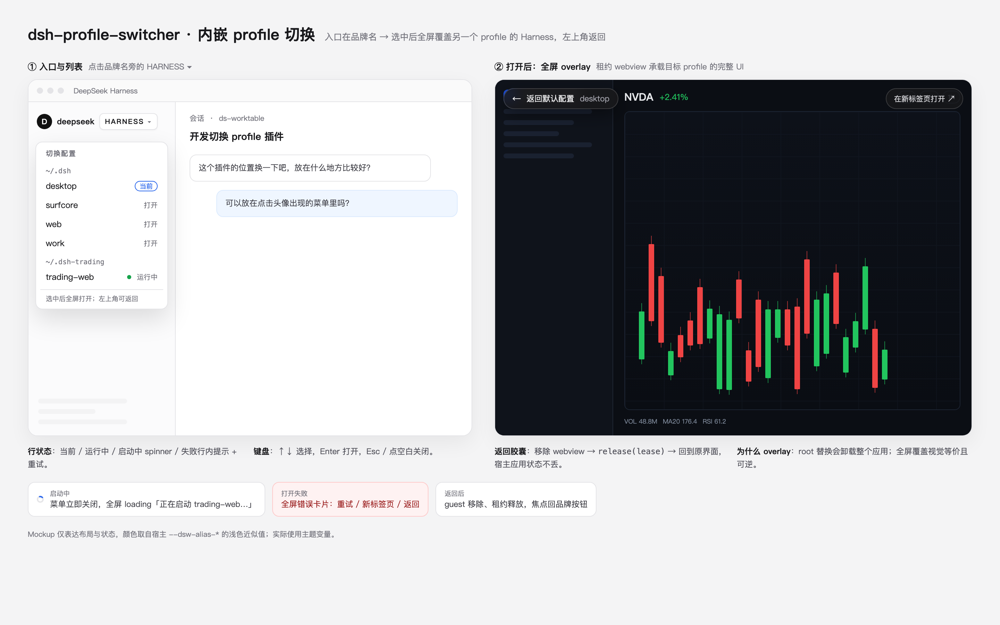

# 内嵌 profile 切换：UI 设计与实施计划



目标：在 `sidebar.brand.name` 放一个 `HARNESS ▾` 触发列表，选中另一个 profile 后，在当前窗口内**全屏覆盖**该 profile 的 Harness（租约 webview），左上角可返回默认 profile。宿主应用全程不卸载。

---

## 1. 范围

**做：**
- 品牌位触发器 + profile 列表（按 home 分组）。
- 启动目标 profile（复用现有 Host `/open`、`/status`、`/stop`）。
- 桌面端用 `window.dshDesktop.browser` 的租约 webview 全屏内嵌。
- 加载 / 失败 / 返回 / 新标签页打开。
- 键盘、焦点、i18n、主题 token。

**不做：**
- 不替换 `root`（会卸载整个应用）。
- 不修改官方 `AccountMenu`。
- 不新增 Host 服务：启动、状态、停止沿用现有路由。
- 不处理目标 profile 的内部主题同步（它有自己的 UI/偏好）。

---

## 2. 交互与状态机

```
idle ──点品牌触发器──▶ menu
menu ──选 profile──▶ overlay.starting   // 菜单立即关闭，全屏 loading
overlay.starting ──ready──▶ overlay.embedded(url)
overlay.starting ──失败──▶ overlay.error
overlay.embedded ──返回──▶ idle
overlay.error ──重试/返回/新标签页──▶ overlay.starting / idle
```

- 点选 profile 的瞬间菜单关闭、**立即挂全屏 overlay**（先显示 loading 卡片），不存在“菜单和 webview 同时可见”的中间态。
- 目标服务器在 overlay 的 loading 阶段启动；ready 后把租约 webview 放进 overlay 并隐藏卡片。
- 已 `ready` 的 profile 再点一次直接复用 URL（秒开）。
- 同一时间只允许一个 overlay；返回时若仍在 starting，取消本次打开（已启动的服务器保留）。

---

## 3. UI 规格

### 3.1 品牌触发器（`sidebar.brand.name`，single）

- 内容：`deepseek` 品牌名右侧的 `HARNESS ▾`（单槽替换，需仿官方 fallback 字样：大写、字距、细边框/无边框）。
- 尺寸：高度 24px，水平 padding 7px，圆角 6px，字号 10px/650，字符间距 0.12em。
- 状态：默认透明；hover / menu 打开时 `--dsw-alias-bg-layer-2`，`--dsw-alias-label-primary`。
- 无障碍：`<button aria-haspopup="menu" aria-expanded>`；tooltip「切换配置」。
- 深色主题用同一组 token，品牌字样颜色跟随 label。
- 侧栏收起成 rail 时该槽不渲染，且按你的选择**不再保留 footer 入口**——rail 下需要先展开侧栏才能切换。

### 3.2 列表（锚定 popover）

- 锚点：品牌触发器下方 6px；`position: fixed`，宽度 248px，`max-height: min(60vh, 480px)`，超出滚动。
- 定位：左对齐触发按钮，clamp 到窗口内（左右 8px）；下方空间不足时向上翻转。
- 结构：
  - 标题行：`切换配置`（10.5px 大写字距，secondary）。
  - 每个 home 一个小标题（等宽字体，secondary），例如 `~/.dsh`、`~/.dsh-trading`。
  - 行：profile 名（可省略号） + 右侧状态：
    - 当前：`当前` 胶囊（brand 边框）
    - 运行中：绿点 + `运行中`
    - 启动中：spinner
    - 失败：红色短文本；hover 显示完整错误
    - 空闲：hover 出现 `打开`
  - 底部提示：`选中后全屏打开；左上角可返回`（10px，secondary，上边框）。
- 键盘：↑/↓ 移动，Home/End，Enter/Space 打开，Esc 关闭；打开时聚焦第一行，关闭后焦点回触发器。
- 空白点击关闭；滚动/窗口 resize 关闭或重新定位（简单起见关闭）。
- hover 背景 `--dsw-alias-bg-layer-2`，圆角 6px。

### 3.3 启动中（全屏 loading）

- 点选后菜单立即关闭，overlay 立刻铺满窗口：背景 `--dsw-alias-bg-base`，中央卡片显示 spinner + 「正在启动 trading-web…」。
- 左上返回胶囊从这一阶段就可用：点击取消本次打开并回到应用（服务器若已拉起则保留，下次秒开）。
- 就绪后：创建租约 webview，loading 卡片淡出，guest 接管整个区域。
- 失败：卡片切换为错误态（原因 + `[重试] [在新标签页打开] [返回]`），不进入 embedded。

### 3.4 全屏内嵌 overlay

- 点选即挂载：层级 `shell.overlay`，`position: fixed; inset: 0; z-index: 1500`，背景 `--dsw-alias-bg-base`（避免 guest 出现前闪白/闪黑）。
- 同一容器承担三个阶段：`starting`（无 webview，仅 loading 卡片）→ `embedded`（webview 替换卡片）→ `error`。
- 顶部收边：
  - macOS：容器顶部留 36px（避开红绿灯），该条背景用 `--dsw-alias-bg-base`，并设 `-webkit-app-region: drag` 保留窗口拖动；
  - Windows：类似 40px（标题栏 overlay 高度）；其他平台 0。
  - webview 从收边下方开始（`top: inset`），宽高填满其余区域。
- 返回胶囊（左上，`inset` 下方 10px / 左 12px）：
  - 内容：`← 返回默认配置` + 当前 profile 名（secondary）；
  - 高 30px，圆角 999px，背景 `--dsw-alias-bg-layer-1` + 边框 + 阴影，`-webkit-app-region: no-drag`；
  - 点击立即返回（不二次确认）。
- 次级按钮（右上）：`在新标签页打开 ↗`（ghost，30px 胶囊），调 `window.open(url)`；桌面端会落到系统浏览器。
- 加载态：overlay 挂载后先显示 `正在启动/打开 trading-web…`；guest `dom-ready` + `did-stop-loading` 后淡出卡片。
- 失败态：居中卡片：`无法打开 trading-web` + 原因 + `[重试] [在新标签页打开] [返回]`；同时清理 guest 与租约。
- 返回：移除 webview 元素 → `dshDesktop.browser.release(lease)` → 卸载 overlay → 焦点回品牌触发器；宿主应用状态（会话、滚动位置）不丢。
- webview 属性（与官方浏览器面板一致，保证输入/快捷键桥接）：
  - `src="about:blank#<lease>"`
  - `partition=<partition>`
  - `name=<lease>`
  - `data-sidebar-browser-frame="webview"`
  - `allowpopups`（空属性）
  - `dom-ready` 后 `element.loadURL(url)`

### 3.5 文案（zh / en）

| key | zh | en |
|---|---|---|
| trigger | HARNESS（品牌字样）+ ▾ | 同 |
| menu.title | 切换配置 | Switch profile |
| menu.hint | 选中后全屏打开；左上角可返回 | Opens full-screen; use the top-left button to go back |
| row.current | 当前 | Current |
| row.running | 运行中 | Running |
| row.open | 打开 | Open |
| start.starting | 正在启动 {name}… | Starting {name}… |
| start.failed | 启动失败 | Could not start |
| embed.loading | 正在打开 {name}… | Opening {name}… |
| embed.failed | 无法打开 {name} | Could not open {name} |
| embed.back | 返回默认配置 | Back to default |
| embed.newTab | 在新标签页打开 | Open in new tab |
| embed.retry | 重试 | Retry |

### 3.6 Token

`--dsw-alias-bg-base` / `bg-layer-1` / `bg-layer-2` / `border-l1` / `border-l2` / `label-primary` / `label-secondary` / `brand-primary` / `state-error-primary` / `state-success-primary`。阴影用 `rgba(0,0,0,.32)`（与现有一致）。

---

## 4. 技术设计

### 4.1 为什么必须是「租约 webview」

桌面主进程的 `will-attach-webview`（`lib/main.js`）只放行：

- `params.src === "about:blank#<lease>"`
- `params.partition === lease.partition`
- `lease.owner === 主窗口 webContents`、未 attach

裸 `<webview src="http://…">` 会被 `preventDefault()`。插件可用的官方入口是 preload 在主 frame（`dsh-app://app`）暴露的：

```js
const bridge = globalThis.dshDesktop?.browser   // { acquire, release, onOpenRequested }
const { lease, partition } = await bridge.acquire('profile-switcher')
```

导航白名单 `allowedNavigation`：`http/https`、无用户名密码、**不是当前应用 host（同 host + 同端口）**。另一个 profile 的服务器是不同端口 → 允许。

### 4.2 客户端结构（单文件 `client.js`）

```
store (menu/launcher 状态)
├─ BrandTrigger            → 注册 sidebar.brand.name
├─ ProfileMenu             → shell.overlay，锚定列表（复用现实现改造）
└─ EmbedSurface            → shell.overlay，全屏容器 + webview + 返回胶囊 + 错误卡片
```

状态放在模块级 store（不用 context），与现有实现一致：

```ts
{
  menuOpen, anchorRect,
  phase: 'idle' | 'starting' | 'embedded' | 'error',
  target?: { home, name },
  url?: string,
  error?: string,
  startedAt?: number,
}
```

### 4.3 启动

复用 Host 现有接口：

1. `POST /api/profile-switcher/open { home, name }`
2. 轮询 `GET /status?home&name`，800ms 间隔，最长 120s
3. `ready` → `embed(url)`；`error` → 展示

### 4.4 内嵌生命周期

```
embed(url):
  bridge = dshDesktop?.browser
  if (!bridge) return fallbackWindowOpen(url)
  { lease, partition } = await bridge.acquire('profile-switcher')
  el = document.createElement('webview')
  el.setAttribute('src', `about:blank#${lease}`)
  el.setAttribute('partition', partition)
  el.setAttribute('name', lease)
  el.setAttribute('allowpopups', '')
  el.dataset.sidebarBrowserFrame = 'webview'
  container.appendChild(el)
  await domReady(el, 8s)
  el.loadURL(url)            // 允许的跨端口 origin
  await didStopLoading(el, 30s)
  el.focus()

return():
  disposeListeners()
  el.remove()                // guest destroyed
  bridge.release(lease)
  clear state
```

- `dom-ready` / `did-stop-loading` / `did-fail-load` / `render-process-gone` / `destroyed` 监听全部用 `AbortSignal` 或在 return 时解除。
- 不把 token URL 写日志；只在内存与 overlay 状态里使用。
- 组件卸载（插件禁用、页面卸载）走同一 `return()` 清理；`release` 失败只记录、不阻塞 UI。

### 4.5 平台收边与窗口拖动

宿主页面已经有现成的事实来源（preload 的 `markDocumentPlatform()` / `syncWindowFullscreen()` 写入）：

- `document.documentElement.dataset.platform`：`darwin` / `win32` / `linux`
- `data-fullscreen`：全屏时存在，收边应归零
- CSS 变量 `--dsh-frame-top-clearance`：宿主为红绿灯/标题栏预留的顶部高度（px）
- `data-windows-titlebar` + `--dsh-windows-titlebar-height`：Windows 标题栏 overlay 高度

实现：

```js
const root = document.documentElement
const fullscreen = root.hasAttribute('data-fullscreen')
const platform = root.dataset.platform
const cssTop = Number.parseFloat(getComputedStyle(root).getPropertyValue('--dsh-frame-top-clearance'))
const inset = fullscreen ? 0 : (Number.isFinite(cssTop) && cssTop > 0 ? cssTop : (platform === 'darwin' ? 38 : platform === 'win32' ? 40 : 0))
```

- 顶部收边条高 `inset`，背景 `--dsw-alias-bg-base`，`-webkit-app-region: drag`；胶囊/按钮 `no-drag`。
- webview 从 `top: inset` 开始铺满剩余区域。
- 若 CSS 变量未来改名，回退到平台默认值，不影响功能。

### 4.6 降级

- 非桌面（`dsh web` 浏览器）：没有 `dshDesktop.browser` → 维持现状，`window.open(url)` 新标签页打开，并在菜单底部提示。
- `acquire` 失败 / `dom-ready` 超时 / guest 崩溃：清理 + 错误卡片，提供「在新标签页打开」。
- 目标 profile 缺 `dsh-web-app`：服务器启动失败 → 现有 status error 展示。

---

## 5. 文件与改动

| 文件 | 改动 |
|---|---|
| `client.js` | 新增 `BrandTrigger`、`EmbedSurface`、launcher store；改造 `ProfileMenu` 为下向锚定；`sidebar.brand.name` 注册；移除现有 `sidebar.footer.action` 注册 |
| `locale/*.json` | meta 不变；新增文案走 client 字典（zh/en） |
| `README.md` | 使用方式、桌面限制、回滚 |
| `docs/embed-switch-plan.md` | 本文档 |
| `docs/mockup.png` | UI 示意 |
| Host `index.js` | 不改 |

---

## 6. 分阶段实施

| 阶段 | 内容 | 验证 | 预估 |
|---|---|---|---|
| P0 尖刺 | 临时「内嵌测试」菜单项：启动 `work` 并内嵌；验证 acquire/loadURL/输入/返回/租约释放 | 桌面手动：guest 能交互，返回后再次 acquire 成功（无租约泄漏） | 0.5d |
| P1 触发器 | `BrandTrigger` 注册 `sidebar.brand.name`，替换 fallback；probe 验证单槽接管 | probe + 桌面截图对比品牌样式 | 0.5d |
| P2 列表 | 菜单下向锚定、分组、状态、键盘/焦点；移除 footer 入口 | probe：键盘、关闭、只留品牌入口 | 0.5d |
| P3 内嵌 | `EmbedSurface`：点选即全屏 loading、就绪换 webview、收边、错误、返回、新标签页；降级 | 桌面：切换 work/trading-web，返回，重复 3 次 | 1d |
| P4 打磨 | i18n、深浅色、返回后焦点恢复、启动中返回的取消语义 | 检查表 | 0.5d |
| P5 清理 | 移除临时测试项；确认无 footer 入口；文档 | 回归 + 插件卸载测试 | 0.5d |

---

## 7. 验证矩阵

| 场景 | 期望 |
|---|---|
| 菜单打开/关闭 | 锚定正确、不超出侧栏、Esc/外点关闭、焦点回触发器 |
| 当前 profile | 显示「当前」，不可点 |
| 启动 `work` | 点选后菜单关闭、立即全屏 loading → guest UI |
| guest 交互 | 输入框可输入、模型菜单可开、滚动/图表正常、Cmd+C/V 正常 |
| 返回 | guest 销毁、租约释放、宿主 UI 原状态恢复、焦点回触发器 |
| 连续切换 3 次 | 每次新 lease；无残留 guest / 端口进程重复 |
| 启动失败 | 行内错误、可重试；不进入 embedded |
| guest 崩溃 / 加载失败 | 错误卡片，可重试/返回/新标签页 |
| `dsh web`（无 bridge） | 新标签页打开 + 提示 |
| 插件禁用/重载 | overlay 与 guest 清理干净 |
| 应用退出 | 无崩溃、无残留 child（Host 现有 killAll） |
| 深浅主题 | 菜单/胶囊/错误卡片颜色正确 |
| rail 侧栏 | 品牌槽不渲染（预期）；展开侧栏后可切换 |

---

## 8. 风险与缓解

| 风险 | 缓解 |
|---|---|
| `sidebar.brand.name` 单槽接管不生效/冲突（已有 fallback -1000000、inactive 0 两个 occupant） | P1 先在 probe 注册验证；失败则改用 `sidebar.brand.mark` 或品牌 mark 旁的自绘触发器 |
| 品牌样式失真 | 复制官方 fallback 字号/字距/边框；截图对比；必要时回退到品牌 mark 旁的独立按钮 |
| 收边/红绿灯遮挡 | macOS 36px、Windows 40px 收边条 + 拖动区 |
| guest 输入/快捷键不生效 | 严格复刻浏览器面板属性（name/partition/data-sidebar-browser-frame） |
| WebSocket/资产加载失败 | guest 是普通 Web 会话，cookie 由 token URL 设置；失败落错误卡片 |
| 租约泄漏 | `return()` 与组件卸载统一清理；P0 验证二次 acquire |
| 目标 profile 与当前共用 `$DSH_HOME` 导致并发写 | 文档提示：建议独立 home；不阻止（现有行为） |
| 桌面 API 版本变化 | 全部 `?.` 守卫 + 无 bridge 降级 |
| 插件自身回归导致白屏 | overlay 不替换 root；最大风险是 brand 槽样式；可 `plugin_manager` 禁用 |

---

## 9. 回滚

- 移除 `sidebar.brand.name` 注册（可回退到上一版 footer 实现，源码在 git/备份里）。
- 最坏：`plugin_manager.set_plugin('include:profile-switcher', false)`；profile 文件不变。

---

## 10. 验收标准

1. 品牌位出现 `HARNESS ▾`，外观与宿主一致（浅/深色、rail 正常）。
2. 列表按 home 分组，当前/运行中/启动中/失败状态正确，键盘可用；无 footer 入口。
3. 选中 `trading-web`：全屏加载目标 UI，可正常交互。
4. 左上角返回：秒回宿主，状态不丢，再次打开仍可成功（租约无泄漏）。
5. 浏览器构建下降级为新标签页，不报错。
6. 插件禁用/应用退出无残留 guest 或子进程。
